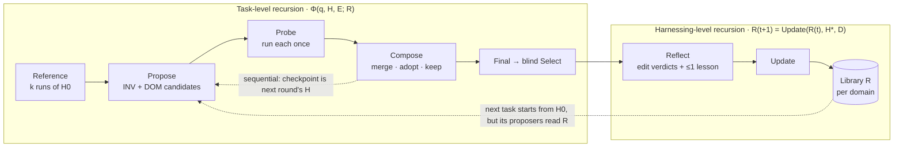

# Harness² Lab

**A readable, from-scratch implementation of [Harness²: Recursive Agent Harnessing for an Open World](https://arxiv.org/abs/2610.14224) (Xu et al., Google Cloud AI Research & Northwestern, 2026), plus a web lab that runs it live in your browser.**

> Agent = Model + Harness. Keep the model frozen; improve the harness, recursively, with no ground truth.

- 🧪 **Run Lab**: watch every reference run, INV/DOM proposal, probe, composition, blind selection, reflection and library update as it happens. Click any card to see its diff, notes, harness files or full trajectory.
- 📚 **Library**: the improvement harness *R*. Each entry holds the full adopted tree plus the lesson its evidence supported.
- 📈 **Budget Lab** (side quest): *adaptive* recursion, the paper's stated future work, swept against fixed-k recursion on a compute/score Pareto frontier.
- 🔭 **Observatory** (side quest): a lineage DAG per task showing which edits survived composition and which components came from the library.
- 🔌 **Bring your own model**: the default is an offline simulator; Claude and any OpenAI-compatible endpoint (Hugging Face router, OpenRouter, Gemini, a local vLLM) also work.

It deploys to **Hugging Face Spaces** as a Docker Space with no secrets ([docs/DEPLOY.md](docs/DEPLOY.md)).

---

## The method in one picture



- **INV** candidates fix *how the agent works*: tool use, verification, budget, mechanical slips. **DOM** candidates add *what a practitioner knows*.
- Every candidate is **probed** once on the same task. The composer keeps an edit only when a trajectory shows it working (a *behavioural contrast*), never because of a score; there is no score.
- **Parallel** (width k): 2k candidates from shared evidence, k independent composers, then a blind selector picks one of the k finals. **Sequential** (depth k): k rounds, each editing the previous checkpoint. Both cost **4k rollouts + 3k improvement stages**.
- After each task a **reflector** writes per-edit verdicts and at most one transferable lesson. The adopted harness and its lesson enter a per-domain library that the next task's proposers read.

A harness has eight editable components (paper Table 5):

| | Component | File | In context |
|---|---|---|---|
| C1 | System prompt | `systemprompt.md` | always on |
| C2 | Guardrails | `guardrails.md` | always on |
| C3 | Memory | `LongTermMEMORY.md` | always on |
| C4 | Tool guidance | `tool_descriptions/tool_guidance.md` | always on |
| C5 | Subagents | `sub_agents/<name>/AGENT.md` | own context, via `task` |
| C6 | Skills | `skills/<name>/SKILL.md` (+`scripts/`) | on demand, via `skill` |
| C7 | Scripts | `scripts/<name>.py` | on demand, via `run_script` |
| C8 | Plugins | `plugin/<name>.json` | inside the tool loop (enforces, not instructs) |

## Quick start

```bash
pip install -r requirements.txt

# the web app (http://localhost:7860)
uvicorn app.server:app --port 7860

# the CLI, on the offline simulator
python -m h2lab.cli --tasks fin-01,fin-02,fin-03 --k 2 -v

# the CLI, on a real model
ANTHROPIC_API_KEY=... python -m h2lab.cli --backend anthropic --tasks ops-02 --k 1
HF_TOKEN=... python -m h2lab.cli --backend openai --base-url huggingface --model <model-id> --tasks ana-01

# tests (43, all offline; runtime depends on platform)
pip install -r requirements-dev.txt && python -m pytest -q
```

Verbose CLI output from a real simulator run (third finance task, k=2, after two tasks have filled the library):

```text
== fin-03 (finance) — Vendor statement vs AP ledger | library entries: 2
   [INV    ] inv1  ~guardrails.md
             · guardrail edit in `guardrails.md` -> repeated, failed in 2/2 runs (base1: 'I'll make the field names more readable…')
             · reused a `guardrails.md` rule (verify) from the finance library -> lesson in INDEX.md
   [DOM    ] dom1  +skills/finance-reconciliation/SKILL.md, ~guardrails.md, ~systemprompt.md
             · skill edit in `skills/finance-reconciliation/SKILL.md` (starting from the library's skill) -> divergence, failed in 1/2
             · general carefulness paragraph in `systemprompt.md` -> risk
   [COMPOSE] agg1  +skills/finance-reconciliation/SKILL.md, ~guardrails.md
             · kept -> skills/finance-reconciliation/SKILL.md from dom1 -> 'Treating every amount as a positive charge…' gone in dom1's probe
             · dropped -> systemprompt.md from dom1 -> no observable mechanism
   [select ] chose agg2: cand-B conforms to the requested shape and its figures check out against the source …
   [reflect] lesson: Deliver exactly the fields, columns and headings the task names …
   => base 71.4  ->  Harness² 100.0  (+28.6)
```

## Repository tour

Start reading at `pipeline.py` and follow the calls. Every module is short.

| Paper concept | Module | Lines |
|---|---|---|
| The two-level loop over a task stream | [`h2lab/pipeline.py`](h2lab/pipeline.py) | ~245 |
| Φ = Propose → Probe → Compose; parallel (Eq. 2) and sequential (Eq. 3) | [`h2lab/recursion.py`](h2lab/recursion.py) | ~180 |
| One improver stage: evidence → agentic edit → repair → validate → retry | [`h2lab/stages.py`](h2lab/stages.py) | ~140 |
| Evidence workspaces; the no-grader guard | [`h2lab/context.py`](h2lab/context.py) | ~140 |
| Blind selector over anonymous finals | [`h2lab/selection.py`](h2lab/selection.py) | ~85 |
| Reflect: edit verdicts + one lesson | [`h2lab/reflection.py`](h2lab/reflection.py) | ~45 |
| Library update (Eq. 4) | [`h2lab/library.py`](h2lab/library.py) | ~100 |
| Stage prompts (App. H, condensed) | [`h2lab/prompts.py`](h2lab/prompts.py) | ~330 |
| H = (c¹…c⁸): surface, validation, diff | [`h2lab/harness.py`](h2lab/harness.py) | ~430 |
| C8 middleware (declarative plugins) | [`h2lab/plugins.py`](h2lab/plugins.py) | ~200 |
| A(q; M, H): mounting a harness, one rollout | [`h2lab/runtime.py`](h2lab/runtime.py) | ~180 |
| The tool-use agent loop (executor and improvers) | [`h2lab/agent.py`](h2lab/agent.py) | ~225 |
| Sandboxed workspace and code execution | [`h2lab/sandbox.py`](h2lab/sandbox.py) | ~205 |
| Model backends: Claude, OpenAI-compatible | [`h2lab/llm/`](h2lab/llm) | ~430 |
| 9 tasks × hidden graders | [`h2lab/tasks/`](h2lab/tasks) | ~1,090 |
| Offline simulator (test double for every role) | [`h2lab/sim/`](h2lab/sim) | ~1,190 |
| **Side quest**: adaptive recursion | [`h2lab/adaptive.py`](h2lab/adaptive.py) | ~110 |
| **Side quest**: lineage and library provenance | [`h2lab/provenance.py`](h2lab/provenance.py) | ~105 |
| **Side quest**: Budget Lab sweep | [`h2lab/budget_lab.py`](h2lab/budget_lab.py) | ~115 |
| Web app: FastAPI + SSE + vanilla-JS SPA | [`app/`](app) | ~1,700 |

## The built-in task suite

Nine professional tasks in three domains. Each has input files, an exact deliverable spec and a **hidden grader** that scores deliverables only after a task is finished. Domain knowledge recurs *within* a domain, which is what the library can carry.

| Domain | Tasks | Recurring practitioner knowledge |
|---|---|---|
| finance | invoice ↔ payment reconciliation · expense summary with FX and refunds · vendor statement vs AP ledger | partial payments aggregate; credits are negative; one-sided items are reported; convert before aggregating |
| ops | incident report from a 47 KB two-host log · deploy ↔ alert correlation · SLO burn report | normalise UTC offsets; error rate counts 5xx over all requests; scope to the service; incident-report anatomy |
| analytics | NPS readout · A/B readout · ordered signup funnel | count people, not rows; NPS denominator includes passives; exclude contaminated units; funnel steps are ordered |

## Side quest: adaptive recursion (Budget Lab)

The paper fixes k per task and names *"adaptive recursion that allocates budget by difficulty or stops when probes add little"* as future work (App. G). [`h2lab/adaptive.py`](h2lab/adaptive.py) implements both halves using **only label-free signals**:

- **Difficulty d(q)**: a noisy-OR of the reference runs' non-delivery rate, tool-error rate and disagreement between their deliverables.
- **Probe gain gₜ**: how far checkpoint cₜ's rollout moved from the previous on-policy rollout. When Compose keeps the checkpoint, or the probe barely moves, the loop stops.
- **BudgetAllocator**: `k_t = clamp(round(share · (0.6 + 0.8·d)), 1, B_left − (tasks_left − 1))`. Easy tasks lend depth, hard ones borrow it, and early stops return steps to the pool.

Simulator sweep: 9 tasks × 12 seeds per policy, with common random numbers (`python scripts/budget_lab.py --seeds 12`).

| Policy | Score ± SE | Agent sessions / task | Mean k | Pareto |
|---|---|---|---|---|
| Base harness H0 | 61.0 ± 4.7 | 1.0 | — | ● |
| Parallel k=1, w/o composition | 79.2 ± 3.1 | 7.0 | 1 | ● |
| Parallel k=1 | 74.1 ± 3.0 | 8.0 | 1 | |
| Parallel k=1, w/o library | 72.4 ± 3.4 | 8.0 | 1 | |
| Parallel k=1, w/o scoping | 77.6 ± 3.3 | 8.0 | 1 | |
| **Adaptive B=1.5N** | 82.3 ± 3.2 | 12.0 | 1.29 | ● |
| Adaptive B=2N | 82.3 ± 3.6 | 12.8 | 1.40 | |
| **Adaptive B=3N** | 85.2 ± 1.7 | 13.6 | 1.53 | ● |
| Sequential k=2 | 89.7 ± 1.5 | 15.9 | 2 | ● |
| Parallel k=2 | 91.3 ± 2.4 | 16.0 | 2 | ● |
| Sequential k=3 | 94.5 ± 1.4 | 23.0 | 3 | ● |
| Parallel k=3 | 92.9 ± 1.5 | 23.0 | 3 | |

**Finding.** In this toy world, adaptive allocation lands **on** the frontier between fixed k=1 and k=2: it gets what its spend predicts, but it does not beat fixed recursion at equal cost. The simulator's knowledge gaps are *persistent*, so reference runs agree on their mistakes and disagreement under-estimates difficulty. A label-free difficulty signal sees uncertainty, not shared bias, which is the same limitation the paper flags for behavioural contrasts. The ablations at k=1 sit within one or two standard errors of each other. "w/o composition" wins here because choosing between two already-probed deliverables is a best-of-2 draw ([docs/DESIGN.md](docs/DESIGN.md#3-the-simulator)).

## What is real, and what is simulated

- **Real everywhere**: the agent loop, sandboxed tools, plugin middleware, the validator (trigger lines, template braces, dangling scripts, compile errors, a single retry then fallback), evidence workspaces, Propose/Probe/Compose, both recursion modes, blind selection, reflection, the library, provenance, and the hidden graders.
- **The simulator** (default, no key) is a *test double*. Scripted but stochastic policies drive every role through those same code paths, with persistent knowledge gaps, visible symptoms and realistic improver mistakes. Its numbers describe a toy world, not the paper's benchmarks. See [docs/DESIGN.md](docs/DESIGN.md).
- **Real models**:
  - **Claude**: official `anthropic` SDK, manual tool loop. It defaults to `claude-opus-5-5` for both executor and editor; the paper pairs a strong editor with cheaper executors, and `claude-haiku-5-5` / `claude-sonnet-5-5` are one click away. Requests are streamed with eager tool-input streaming and validated inputs, prompt caching is on, and the server-side `fallbacks: "default"` refusal fallback is enabled where the model supports it.
  - **OpenAI-compatible**: any `chat.completions` endpoint with function calling.

Keys typed into the web app are used for that run only and never stored or logged. Real runs are limited by task count and k. The USD threshold is checked between tasks using estimated costs; an in-flight task can exceed it. OpenAI-compatible endpoints currently report token usage without dollar pricing, so the threshold does not limit their spend. Set billing limits with your model provider.

## How this differs from the official release

The [official code](https://github.com/google-research/harness2) drives OpenCode/Codex executors against WorkBuddy-Bench, JobBench and LAB. This project rebuilds the method small enough to read in an afternoon:

- a minimal agent loop instead of OpenCode/Codex
- JSON plugins instead of TypeScript, so a public demo never executes model-written middleware
- nine built-in tasks with hidden graders instead of the benchmarks
- condensed stage prompts

The schedule, the validation rules, the evidence contract, selection, reflection and the library follow the paper and the release closely. The full comparison table is in [docs/DESIGN.md](docs/DESIGN.md#1-fidelity-to-the-paper).

## Citation

```bibtex
@article{xu2026harness2,
  title   = {Harness^2: Recursive Agent Harnessing for an Open World},
  author  = {Xu, Ruiyao and Chen, Yanfei and CuiZhu, Zhongying and Dalvi Mishra, Bhavana and
             Ming, Yifei and Yu, Han and Han, Rujun and Lee, Chen-Yu and Pfister, Tomas},
  journal = {arXiv preprint arXiv:2610.14224},
  year    = {2026}
}
```

Apache-2.0. This is an independent implementation, not affiliated with the paper's authors; see [NOTICE](NOTICE) for attribution of the adapted prompts.
